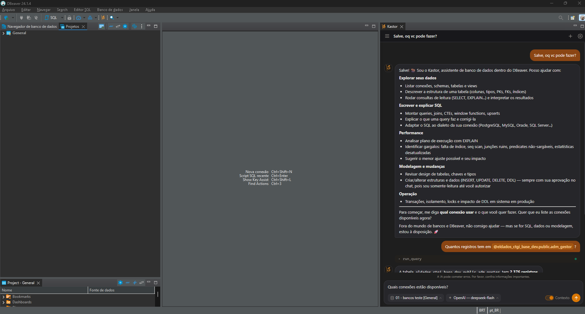
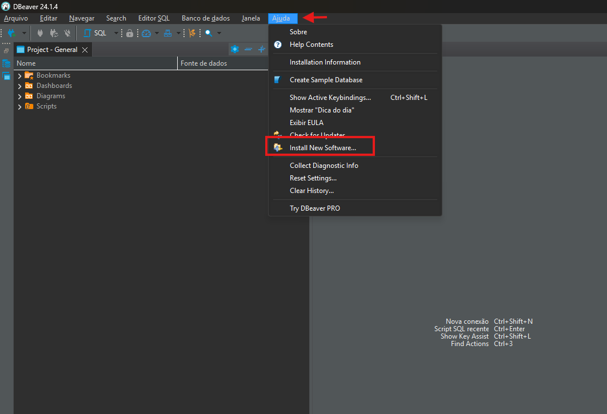
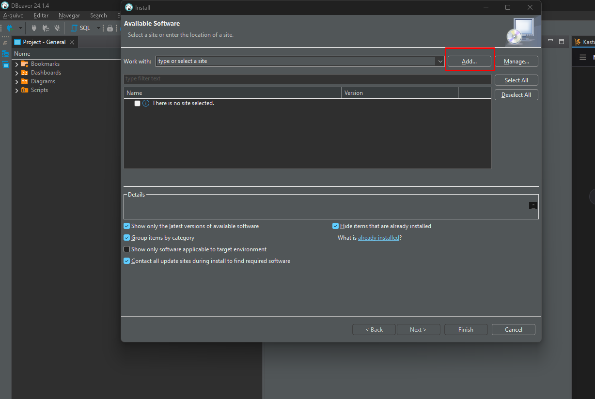
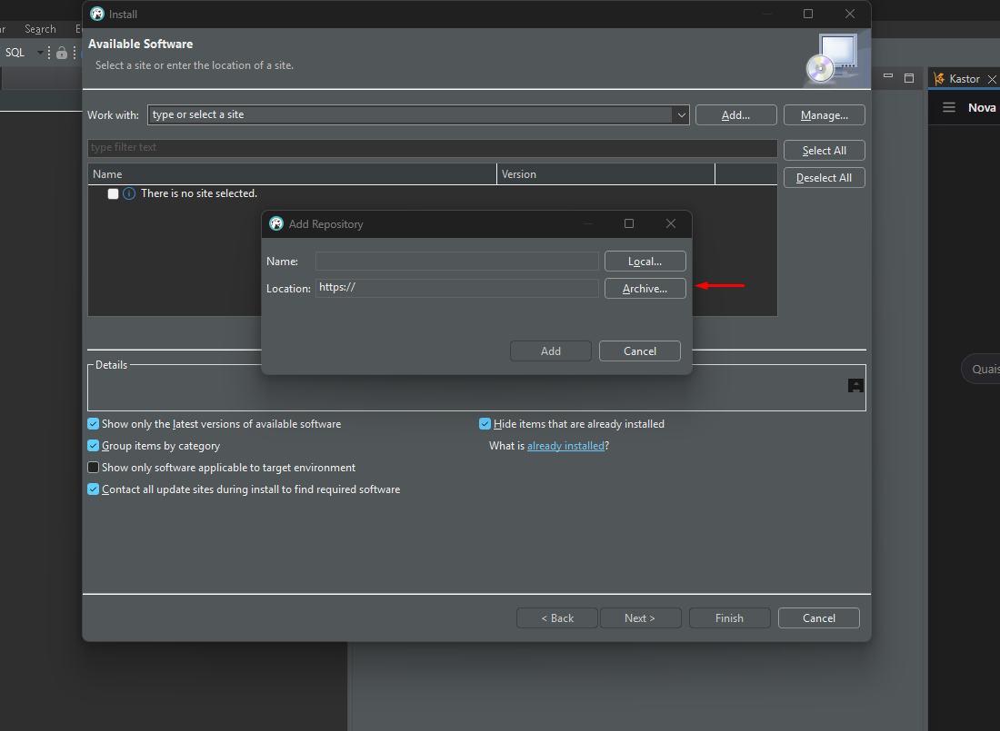
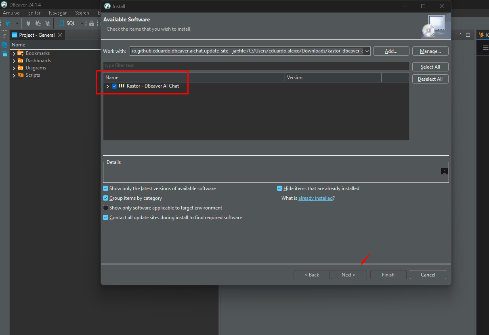
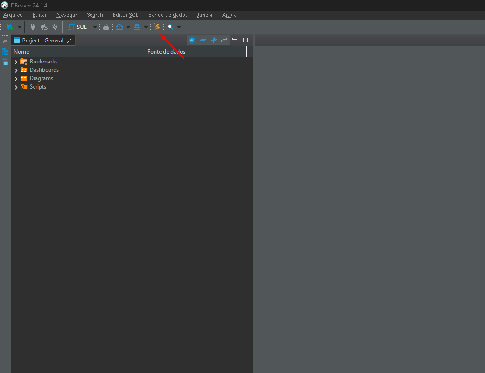

# Kastor - DBeaver AI Chat

<p align="center">
  
</p>

Chat de IA dentro do DBeaver (CE 24.1.0 ou mais novo) com acesso às conexões configuradas.
Use o modelo que quiser: qualquer API compatível com OpenAI (OpenAI, Ollama, LM Studio, OpenRouter, Groq...) ou a API da Anthropic.



## Get started

### Requisitos

- DBeaver Community 24.1.0 ou mais novo (Windows, Linux ou macOS).
- Uma chave de API de um provedor de IA, ou um modelo local (Ollama, LM Studio).

### Instalação

Você precisa do arquivo `kastor-dbeaver-ai-chat-vX.X.X.zip` (o update site do plugin).
**[Baixar o instalador mais recente](https://github.com/EduardoRocha234/kastor-dbeaver-ai-chat/releases/latest)** (em *Assets*). Para gerá-lo a partir do código, veja [Build](#build).
Não é preciso extrair o zip.

**1.** No DBeaver, abra **Ajuda (Help) → Install New Software…**



**2.** Clique em **Add…**



**3.** Na janela *Add Repository*, clique em **Archive…** e escolha o `kastor-dbeaver-ai-chat-vX.X.X.zip`.



**4.** Marque **Kastor - DBeaver AI Chat** e clique em **Next >**.



**5.** Avance, aceite a licença e o aviso de conteúdo não assinado (**Install anyway**) e reinicie o DBeaver quando pedir.

Para atualizar, repita os passos com o zip da nova versão. Para remover: **Ajuda → Installation Information → Installed Software**.

## O que o Kastor pode fazer

- Listar conexões, schemas e tabelas; descrever tabelas (colunas, chaves, índices).
- Rodar consultas de leitura (`SELECT`, `SHOW`, `EXPLAIN`) sozinha, com limite de linhas.
- Comandos de escrita (`INSERT`, `UPDATE`, `DELETE`, DDL) **só depois da sua aprovação** no chat.
  Conexões marcadas como somente leitura no DBeaver nunca recebem escrita.

As consultas rodam num contexto de conexão separado do seu editor: leituras terminam em rollback e
escritas aprovadas são confirmadas (commit) na hora.

## Configuração

1. **Window → Preferences → Kastor → Adicionar…**
2. Escolha um modelo pronto (Anthropic, OpenAI, Ollama, LM Studio, OpenRouter) ou "Personalizado".
3. Informe o modelo e a chave de API (guardada no Secure Storage do Eclipse) e clique **Testar**.

## Uso

- Clique no botão **Kastor** (a logo laranja) na barra de ferramentas ou use **Window → Kastor**.
  O painel fica acoplado à direita dos editores, como o chat do VS Code.
  Se ele abrir em outro lugar logo após instalar, use **Window → Reset Perspective** uma vez.

  

- No cabeçalho do painel, escolha o modelo e a conexão (por padrão, a do editor SQL ativo).
- Com "Contexto do editor" ligado, o schema padrão e o SQL selecionado no editor vão junto com a pergunta.
- **Enter** envia; **Shift+Enter** quebra a linha.
- Atalhos: **Ctrl+Alt+K** abre o Kastor de qualquer lugar (mude em Preferences → General → Keys);
  no chat, **Ctrl+Alt+C** abre o seletor de conexão e **Ctrl+Alt+M** o de modelo.
- Digite **@** para referenciar objetos da conexão: a lista filtra conforme você digita e navega
  banco → schema → tabela, carregando só o nível escolhido.
- No navegador de banco de dados: botão direito em um banco, schema ou tabela → **Referenciar no Kastor**
  (ou **Ctrl+Alt+R**, que também funciona com a tabela aberta no editor). O Kastor abre na conexão do objeto
  com `@banco.schema.tabela` no campo de texto.
- No editor SQL: botão direito → **Perguntar ao Kastor sobre a seleção**.
- Blocos SQL da resposta têm os botões **Inserir no editor**, **Abrir em novo editor** e **Copiar**.
- Conversas ficam salvas: o botão ☰ abre a lista (busca, abrir, apagar) e o + inicia uma nova.

## Privacidade e segurança

### Responsabilidade sobre dados enviados a modelos externos

**O Kastor não se responsabiliza pelos dados enviados a provedores de IA externos.**
Ao usar um provedor na nuvem (OpenAI, Anthropic, OpenRouter, Groq etc.), o seguinte sai da sua máquina e passa a
ser tratado conforme os termos, a retenção e a jurisdição desse provedor:

- nomes de conexões, bancos, schemas, tabelas e colunas, e a estrutura das tabelas;
- resultados de consultas, até o limite de linhas e de caracteres configurado;
- o SQL do editor e os objetos `@referenciados`, quando você os inclui na pergunta;
- o texto das suas perguntas e todo o histórico da conversa.

Cabe a você e à sua organização decidir se o uso é permitido (LGPD, contratos, políticas internas) e escolher um
provedor adequado. O Kastor é distribuído "como está", sem garantias de qualquer tipo, nos termos da [licença MIT](LICENSE).
Com Ollama ou LM Studio, tudo fica na sua máquina.

### Controles disponíveis

Em **Window → Preferences → Kastor → Segurança**:

| Controle | O que faz |
| --- | --- |
| **Permitir comandos de escrita** | Desmarcado, o modelo não consegue executar `INSERT`/`UPDATE`/`DELETE`/DDL, nem com aprovação. Leituras continuam. |
| **Colunas mascaradas** | Lista de nomes de colunas (`cpf, *senha*, email`; `*` e `?` são curingas, sem diferenciar maiúsculas). Os valores dessas colunas viram `***` antes de ir ao modelo; `NULL` continua `NULL`. O valor padrão (`DEFAULT`) delas também é omitido em `describe_table`. |
| **Registrar auditoria local** | Grava um arquivo `audit.jsonl` com cada consulta e comando pedido pelo modelo (veja abaixo). Ligado por padrão. |

Já existiam: escrita só com aprovação explícita no chat, bloqueio em conexões somente leitura do DBeaver,
leituras em transação separada com rollback, timeout e limites de linhas/caracteres, e chave de API no
Secure Storage do Eclipse.

### Auditoria local

Um evento por linha (JSON) em `{workspace}/.metadata/.plugins/io.github.eduardo.dbeaver.aichat/audit/audit.jsonl`
(o botão **Abrir pasta** nas preferências leva até lá). Ao passar de 5 MB, o arquivo vira `audit.jsonl.1`
(só uma geração é mantida).

```json
{"time":"2026-10-14T02:11:09Z","user":"maria","tool":"run_query","connection":"prod-pg","sql":"select id, cpf from clientes limit 10","outcome":"executed","rows":10,"maskedColumns":["cpf"]}
```

- `outcome`: `executed`, `rejected` (você negou a aprovação), `blocked` (política ou conexão somente leitura)
  ou `error`.
- O log guarda o **SQL**, não as linhas devolvidas. Mas o SQL pode conter valores literais (`where cpf = '123...'`),
  então trate o arquivo como dado sensível.
- O log é local e não é protegido contra edição por quem tem acesso à máquina. Ele serve para rastrear o uso,
  não como prova forense. Para auditoria de verdade, use também o log do próprio banco.
- Só registra o que passa pelas ferramentas de consulta/escrita. Perguntas e respostas do chat ficam no
  histórico de conversas, em outro lugar.

### Política para o time (administradores)

Para fixar a política em todas as máquinas, adicione ao `dbeaver.ini` (depois da linha `-vmargs`):

```ini
-Dkastor.writes.disabled=true
-Dkastor.mask.columns=cpf,*senha*,email,cartao*
-Dkastor.audit.enabled=true
```

Esses valores só endurecem as preferências do usuário: a escrita fica desligada e a auditoria ligada sem
possibilidade de mudança na tela, e as colunas listadas são somadas às do usuário. Quem tem permissão para editar
o `dbeaver.ini` ainda consegue removê-los; isto é uma proteção contra uso acidental, não contra um usuário
mal-intencionado com controle da máquina. Para isso, use permissões no banco.

### Limites que você precisa conhecer

- **O mascaramento é por nome de coluna no resultado.** Uma consulta que renomeia ou transforma a coluna
  (`select cpf as x`, `select concat(cpf, '')`) escapa dele, e o modelo também pode filtrar por ela
  (`where cpf = '...'`) e deduzir o valor. Mascarar reduz exposição acidental, não impede um modelo
  induzido a extrair dados.
- **Prompt injection:** texto armazenado no banco pode tentar instruir o modelo. Escritas exigem sua aprovação,
  então leia o SQL do card antes de aprovar. Leituras não pedem aprovação.
- **Somente leitura é verificado, não garantido.** Combinamos classificador de SQL, o parser do driver e o modo
  somente leitura do JDBC, que alguns drivers ignoram. A barreira real é o usuário do banco: dê ao Kastor
  conexões com o menor privilégio possível, de preferência um usuário só com `SELECT`.
- O Kastor usa as credenciais da conexão do DBeaver e tem o mesmo poder que você nela.
- O plugin não é assinado. Distribua o update site por canal confiável (HTTPS ou repositório interno).

## Build

```bash
scripts/install-toolchain.sh      # JDK 17 + Maven em ~/.local/opt
scripts/verify.sh 24.1.0          # build + testes contra o DBeaver 24.1.0
scripts/verify.sh latest          # build + testes contra a última versão
```

O update site sai em `releng/update-site/target/kastor-dbeaver-ai-chat-v<versão>.zip`.

## Licença

[MIT](LICENSE) © 2026 Eduardo Aleixo.
